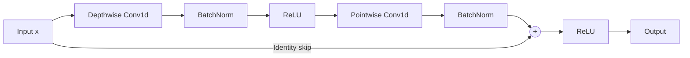
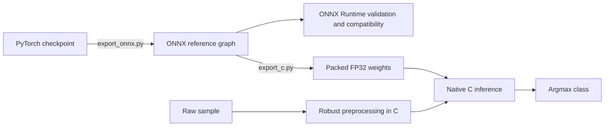

# Optimized ML Solution — GDG on Campus UAM Machine Learning Contest (November 2026)


Our solution for the **GDG on Campus UAM Machine Learning Contest (November 2026)** delivers **high-throughput, low-latency classification of multichannel time series** under a strict CPU-only, single-thread, batch-one inference budget. Each input contains four channels and 256 time steps; the model returns one of eight classes.

The solution combines a residual temporal CNN, robust signal reconstruction, an explicit temporal and cross-channel relation branch, and a specialized native inference engine. Training uses PyTorch, ONNX provides the portable reference graph, and the competition entry point executes preprocessing and prediction in C through a small Python interface.

**Current deployment:** `Model()` in [model.py](model.py) uses the native C engine. ONNX Runtime serves as the numerical reference and as a compatibility backend for retrained ONNX models without packed native weights. Numba accelerates the Python preprocessing used in training and ONNX validation; the default inference path implements the same recipe directly in C.

| System characteristic | Current implementation |
| --- | --- |
| Input / output | Read-only `float32[4, 256]` signal → integer class `0…7` |
| Learned model | 32-channel residual temporal CNN with a relation branch |
| Trainable parameters | **7,352** |
| Model footprint | **28.3 KB packed FP32 binary** (`weights.bin` with SHA-256 header) |
| Runtime dependency | NumPy + Linux/WSL with a C11 compiler |
| CPU execution | Sequential inference; AVX2/FMA dispatch with scalar fallback |
| Mean native prediction latency | **42.19 µs** |
| IID test accuracy | **91.65%** |
| Demo accuracy | **86.50%** |

## Competition Challenge & Evaluation Contract

The entry point implements `Model.predict(sample) -> int`, classifying each signal directly from `sample.series`. Input arrays are read-only and can contain missing values.

The supplied [evaluation harness](harness.py) separates setup, warmup, and scored prediction:

| Constraint | Default behavior |
| --- | --- |
| Setup | Untimed for scoring, with a 120-second setup timeout |
| Warmup | Up to 100 samples or 5 seconds of cumulative prediction time |
| Scored budget | **60 seconds of cumulative `predict` time** |
| Inference granularity | One sample per call, strictly sequential |
| Thread configuration | Common numerical-library thread counts set to one |
| Per-call timeout | 0.5-second soft timeout; 0.25-second additional grace |
| Other stop conditions | Stream exhaustion, 10 million samples, or 1,800 seconds of scored wall time |
| Repeated evaluation | Three runs by default, ranked by their mean score |

The 60-second budget includes preprocessing and classification inside `predict`. Dataset generation, process communication, setup, and warmup are separate from that cumulative prediction budget. Consequently, model-time throughput and end-to-end wall-clock throughput are different quantities.

### Geometric mean score

The objective rewards both processing more samples and preserving performance across all classes. For each class $k$, let $n_k$ be its scored sample count, $c_k$ the correct predictions, and $w_k$ the wrong predictions, including failures but excluding abstentions. The default score is:

$$
T_k = \max\left(0.01,\; \sqrt{n_k} \cdot \frac{c_k - 0.33\,w_k}{n_k} \cdot \left(\frac{c_k}{n_k}\right)^2\right)
$$

$$
\text{Score} = \left(\prod_{k=0}^{7} T_k\right)^{1/8}
$$

A class with no observations contributes `0.01`. The current model always predicts a class and does not abstain. The geometric mean makes weak classes consequential, while the sample-count term makes latency part of the optimization objective. Scores from differently sized datasets are not directly comparable.

## Architecture & Design Decisions

The authoritative PyTorch implementation is [src/architecture.py](src/architecture.py). Its exported `TemporalCNN` extends the base temporal network with a learned relation branch.

### Temporal feature extractor

Shapes below omit the batch dimension. Convolutions use zero padding unless specified otherwise.

| Stage | Operation | Output shape | Trainable parameters |
| --- | --- | --- | ---: |
| Input | Independently normalized channels | `4 × 256` | 0 |
| Stem | Conv1d `4 → 32`, kernel 7, padding 3, no bias; BatchNorm; ReLU | `32 × 256` | 960 |
| Downsample 1 | Fixed depthwise `[1, 2, 1] / 4`, replication padding, stride 2 | `32 × 128` | 0 |
| Residual block 1 | Depthwise kernel 5, dilation 1; pointwise mixing | `32 × 128` | 1,312 |
| Downsample 2 | Same fixed low-pass filter and decimation | `32 × 64` | 0 |
| Residual block 2 | Depthwise kernel 5, dilation 2; pointwise mixing | `32 × 64` | 1,312 |
| Downsample 3 | Same fixed low-pass filter and decimation | `32 × 32` | 0 |
| Residual block 3 | Depthwise kernel 5, dilation 4; pointwise mixing | `32 × 32` | 1,312 |
| Residual block 4 | Depthwise kernel 5, dilation 8; pointwise mixing | `32 × 32` | 1,312 |
| Temporal pooling | Per-channel mean and population standard deviation | `64` | 0 |
| Relation branch | 30 signal relations → Linear `30 → 16` → ReLU | `16` | 496 |
| Classifier | Concatenate pooled features and relations; Linear `80 → 8` | `8` logits | 648 |
| **Total** | | | **7,352** |

Each residual block computes:



Depthwise convolutions use 32 groups and padding `2 × dilation`; both convolutions are bias-free. Each block contains 160 depthwise weights, 1,024 pointwise weights, and 128 BatchNorm affine parameters. The fixed low-pass kernels and BatchNorm running statistics are buffers, not trainable parameters.

Pooling concatenates the mean with `sqrt(population_variance + 1e-6)` for each learned channel. The standard deviation captures temporal variability that mean pooling alone would discard.

### Explicit relation features

The second branch operates directly on the normalized input, before temporal downsampling:

- **18 cross-channel features:** mean products for the six unordered channel pairs at lags `0`, `2`, and `8`.
- **12 within-channel features:** mean products for each of four channels at lags `1`, `4`, and `16`.

Each lagged product is averaged over its overlapping time interval. These second-order mean-product features capture temporal and cross-channel dependencies. A `30 → 16` projection with ReLU combines them before fusion with the 64 pooled CNN features.

### Why this compact design fits the task

Depthwise temporal filtering separates temporal pattern extraction from channel mixing, reducing the parameter and compute cost of full convolutions. Three filtered downsampling stages reduce the temporal length from 256 to 32; the fixed filter attenuates high-frequency content before decimation, while replication padding preserves constant signals at the boundaries. Increasing dilation expands temporal context without increasing the kernel's parameter count.

The relation branch explicitly models dependencies that remain useful after channel-wise normalization removes absolute offsets and much of the gain variation. Residual connections support optimization without requiring a wide network. Together, these choices keep inference small enough for specialized CPU kernels and avoid the scheduling and memory costs of much larger recurrent or attention-based models.

### Robust preprocessing

[src/normalize_data.py](src/normalize_data.py) defines the fixed V024 recipe. [native/preprocess.h](native/preprocess.h) implements its native equivalent. Both process each channel independently and preserve the raw input.

1. **Identify finite observations.** Treat both NaNs and positive/negative infinity as missing. An entirely missing channel becomes zero.
2. **Robustly clip finite values.** Calculate the median and median absolute deviation (MAD):

   $\displaystyle \text{scale} = \max\left(1.4826 \cdot \operatorname{median}\left(\left|\text{values} - \operatorname{median}(\text{values})\right|\right),\ 0.001\right)$

   $\displaystyle \text{bounds} = \operatorname{median}(\text{values}) \pm 6 \cdot \text{scale}$

   Clip observed values to these bounds before interpolation, limiting the propagation of spikes into reconstructed samples.

   Clip observed values to these bounds before interpolation, limiting the propagation of spikes into reconstructed samples.
3. **Interpolate within each channel.** Fill internal gaps linearly. Extend the nearest finite value at either boundary. A single finite observation therefore produces a constant reconstructed channel.
4. **Apply channel-wise z-score normalization.** Subtract the temporal mean and divide by `sqrt(mean(centered²) + 1e-6)`.
5. **Bound and cast.** Clip to `[-10, 10]` and return a tensor of shape `(1, 4, 256)` in `float32`.

Intermediate reconstruction and normalization use `float64`. Constant and entirely missing channels normalize to zero. Pass **raw signals** to `Model.predict`; applying normalization beforehand would change the expected pipeline.

The Python reference uses `@njit(cache=True)` with selected fast-math flags (`reassoc`, `contract`, `arcp`, `nsz`) that retain NaN/infinity checks. The ONNX compatibility backend compiles preprocessing for a read-only dummy input during setup. The default C backend requires no JIT or Numba installation.

## Deployment & Optimization Pipeline



### PyTorch to ONNX

[tools/export_onnx.py](tools/export_onnx.py) loads the checkpoint on CPU, checks preprocessing metadata when present, restores the current architecture, and switches to evaluation mode. Export uses the legacy PyTorch ONNX exporter (`dynamo=False`), opset 17, and input/output names `series` and `logits`.

The graph has a **fixed topology and fixed signal dimensions**, but its batch axis is explicitly dynamic: `(N, 4, 256) → (N, 8)`. Competition inference still uses `N = 1`. Preprocessing is outside the graph. BatchNorm is folded into convolution weights and biases in the supported export.

### ONNX Runtime configuration

The `_LegacyOnnx` backend in [model.py](model.py) selects `CPUExecutionProvider` and sets both:

```python
options.intra_op_num_threads = 1
options.inter_op_num_threads = 1
```

It runs Numba preprocessing, executes the ONNX graph, and returns the argmax class. This route is selected only for `Model(trained=True)` when the retrained packed weight file is absent. The shipped model uses the native backend and its bundled packed weights.

### Specialized native execution

[native/runtime.py](native/runtime.py) compiles [native/inference.c](native/inference.c) into a temporary shared library during setup using `cc` (or the compiler in `CC`). Compilation uses `-O3`, `-fPIC`, `-shared`, `-ffp-contract=off`, and `-fno-fast-math`, with a 60-second compiler timeout. The loaded library is cached within the process.

The engine selects AVX2/FMA kernels when the CPU supports them and otherwise uses scalar kernels. Explicit SIMD intrinsics accelerate selected operations without creating inference threads. Fixed tensor shapes allow stack-based intermediate buffers and direct execution of the known graph without a general-purpose graph scheduler.

The packed artifact contains **7,064 FP32 values**, plus a 76-byte header, totaling **28,332 bytes**. This differs from the training parameter count because BatchNorm affine parameters are folded into convolution weights and biases. Fixed filters are implemented directly. The bundled ONNX reference graph occupies **69,661 bytes**.

[tools/export_c.py](tools/export_c.py) validates the graph topology, operator attributes, constants, and fixed downsampling filters. At load time, the runtime checks the artifact's magic value, length, weight count, and payload SHA-256; it also checks the ONNX SHA-256 when the reference file is present. A changed topology requires corresponding native engine and packer changes, not just new weights.

### Numerical parity checks

[tools/validate_native.py](tools/validate_native.py) compares scalar and, when available, AVX2/FMA execution against single-thread ONNX Runtime. Its default mode checks up to 256 dataset samples and 128 synthetic stress cases; `--full` checks every dataset row and 10,000 stress cases.

Stress inputs cover missing channels, all-zero/all-missing signals, infinities, extreme scales, and large finite values. Class predictions are compared across every selected sample. Preprocessing and logit closeness are checked on the first batch of each sample group, using `rtol=1e-5, atol=2e-6` for preprocessing and absolute tolerance `1e-4` for logits.

## Repository Structure

```text
.
├── README.md                     # System overview, reproduction, and measured results
├── model.py                      # Competition Model API and retrained ONNX compatibility
├── requirements.txt              # Minimal inference dependency: NumPy
├── competition_api.py            # Sample contract, dataset loading, class definitions
├── harness.py                    # Official evaluation interface and scoring implementation
├── colab.ipynb                   # Notebook for running the repository in Colab
├── model/
│   ├── README.md                 # Checkpoint provenance and historical accuracy
│   ├── model.onnx                # Exported reference graph
│   ├── weights.bin               # Packed native inference weights
│   └── training/
│       ├── weights.pt            # Selected PyTorch checkpoint
│       ├── training.json         # Recipe, fingerprints, and selected-epoch recall
│       └── history.json          # Per-epoch training and validation metrics
├── native/
│   ├── runtime.py                # Compilation, ctypes bindings, weight integrity checks
│   ├── inference.c               # Specialized scalar and AVX2/FMA forward pass
│   └── preprocess.h              # Robust clipping, interpolation, and normalization
├── src/
│   ├── architecture.py           # PyTorch temporal CNN and relation branch
│   ├── normalize_data.py         # Numba preprocessing reference
│   ├── prepare_data.py           # Dataset download, integrity checks, stratified splits
│   ├── augment_data.py           # Missingness, noise, spikes, gain, and class weights
│   ├── train.py                  # Fixed training recipe and checkpoint selection
│   ├── evaluate.py               # Lightweight demo accuracy evaluation
│   ├── cli.py                    # Shared CLI help behavior
│   ├── requirements.txt          # Training, export, and reference-validation dependencies
│   └── README.md                 # Training workflow notes
├── tools/
│   ├── export_onnx.py            # PyTorch checkpoint → ONNX
│   ├── export_c.py               # Supported ONNX graph → packed native weights
│   └── validate_native.py        # Native/ONNX numerical and prediction comparisons
├── data/
│   └── README.md                 # Dataset download instructions and checksums
└── examples/                     # Provided baseline and ONNX C integration examples
```

Downloaded datasets, evaluation `results/`, and `model/retrained.*` are local artifacts excluded from Git.

## Quickstart & Local Evaluation

### Run the shipped model

**Prerequisites:** Linux or WSL, Python 3.10+, and a GCC-compatible C11 compiler available as `cc`. On Debian/Ubuntu, `build-essential` provides the compiler toolchain. Use `CC` to select another compatible compiler executable.

```bash
git clone https://github.com/marcollor/ml-contest-2026.git
cd ml-contest-2026

python3 -m venv .venv
source .venv/bin/activate
python -m pip install -r requirements.txt

curl -fL -o data/test_demo.npz \
  https://github.com/GDG-UAM/ml-contest-materials/releases/latest/download/test_demo.npz

python harness.py evaluate --model model.py --source file:data/test_demo.npz
```

The model loads the bundled weights and compiles its native engine during setup. The harness performs three runs and writes per-run JSON, worker logs, aggregate metrics, and a leaderboard under `results/`. For a quick accuracy-only check, run `python src/evaluate.py`.

To evaluate throughput on the default local source, download the approximately 413 MB training dataset:

```bash
curl -fL -o data/train_100k.npz \
  https://github.com/GDG-UAM/ml-contest-materials/releases/latest/download/train_100k.npz
python harness.py evaluate --model model.py
```

Dataset checksums are listed in [data/README.md](data/README.md). Use the training-file run for throughput diagnostics and the held-out IID and demo sets for generalization metrics.

### Development: Export, Validate, and Retrain

The [development requirements](src/requirements.txt) add PyTorch, Numba, ONNX, ONNX Runtime, and scikit-learn to the minimal NumPy environment.

**Regenerate and validate the shipped model:**

```bash
python -m pip install -r src/requirements.txt
python -m tools.export_onnx
python -m tools.export_c
python -m tools.validate_native --dataset data/test_demo.npz
```

Export updates `model/model.onnx` and `model/weights.bin`. Repack native weights after each ONNX export to keep graph fingerprints aligned. The packer checks the supported graph signature, and the validator compares predictions with ONNX Runtime. Use `python -m tools.validate_native --full` for all training rows plus 10,000 synthetic stress cases. Record installed dependency versions alongside regenerated artifacts.

**Train and evaluate a new checkpoint** using Python 3.11+, required by the data-fingerprinting utilities:

```bash
python src/prepare_data.py
python src/train.py --check-only
python src/train.py
python -m tools.export_onnx --trained
python -m tools.export_c --trained
python -m tools.validate_native --trained
python src/evaluate.py --trained
```

Data preparation creates disjoint stratified partitions: **70,000 training**, **5,000 development**, **20,000 IID test**, and **5,000 reserve** samples. It also writes `data/val.npz` for harness-based IID evaluation.

| Training setting | Value |
| --- | --- |
| Epochs / batch size / seed | 80 / 256 / `20261114` |
| Loss | Inverse-frequency class-weighted cross-entropy |
| Optimizer | AdamW, `lr=0.002`, `weight_decay=0.001` |
| Learning-rate schedule | Cosine decay to `5e-5` |
| Augmentation | Missingness, noise, spikes, and gain changes; 25% clean samples |
| Checkpoint selection | Maximize the lower clean/stress development score; break ties with the lower accuracy |
| Training device | CUDA when available, otherwise CPU |

The shipped checkpoint was selected at epoch 61. [Training metadata](model/training/training.json) and [epoch history](model/training/history.json) document its recipe, fingerprints, and validation results.

Retraining writes `model/retrained.pt`; the `--trained` export commands create matching ONNX and native artifacts. `src/evaluate.py --trained` selects this new model. The standard harness command loads `Model()` and evaluates the shipped weights. Training can use multiple CPU threads or a GPU; contest inference remains single-threaded on CPU.

## Authors & Acknowledgments

- **[Author Name 1]** — [GitHub](https://github.com/YOUR_GITHUB_USERNAME_1) · [LinkedIn](https://www.linkedin.com/in/YOUR_LINKEDIN_PROFILE_1/)
- **Marcos Leo Sonck Walker** — [GitHub](https://github.com/Leoreo11) · [LinkedIn](https://www.linkedin.com/in/marcos-leo-a5a6352b6)

Thanks to **GDG on Campus UAM** for organizing the competition and providing the datasets, evaluation harness, and baseline materials. This project builds on the work of the **NumPy, PyTorch, Numba, ONNX, ONNX Runtime, and scikit-learn** communities.
